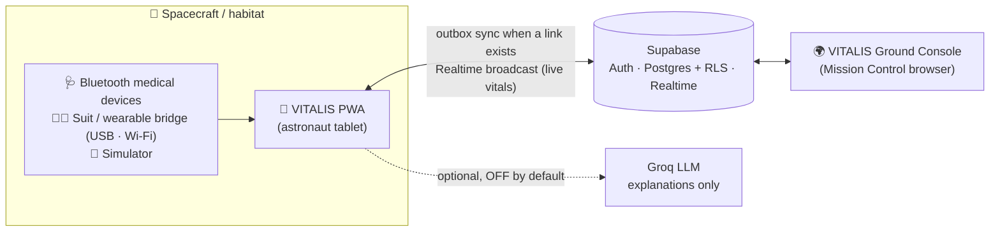
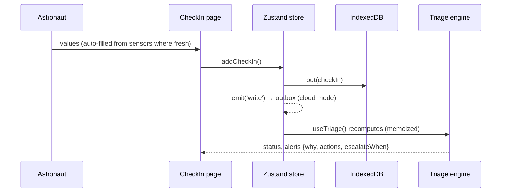
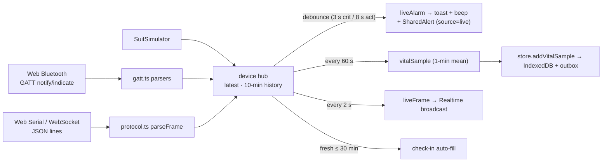
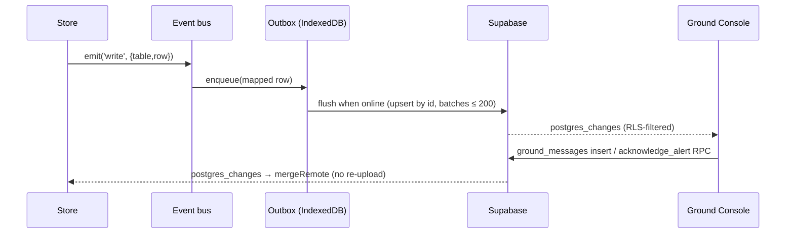

# VITALIS — Architecture

This document describes how VITALIS is built: its layers, data flows, data model, security model and the key design decisions. For a one-page summary see [ARCHITECTURE_ESSENTIALS.md](ARCHITECTURE_ESSENTIALS.md).

---

## 1. Principles

1. **Offline-first.** The device is the source of truth for its own writes. Every feature works without a network; the cloud is a sync target, never a dependency.
2. **Explainable, rule-based triage.** Pure TypeScript functions with unit tests. No black box: every flag carries plain-language reasons.
3. **Decision support, not diagnosis.** Safety copy, sourced thresholds, escalation paths everywhere.
4. **Privacy by default.** Local mode sends nothing. Cloud mode is protected by Row Level Security in the database, not by client code.
5. **Two runtime modes, one codebase.** *Local/demo* (no backend) and *real accounts* (Supabase) share all UI and engine code.

---

## 2. System context



- **Local/demo mode:** no Supabase variables → the app runs entirely in the browser; the ground link and flight-surgeon reply are simulated with the mission's light-time.
- **Real-accounts mode:** `VITE_SUPABASE_URL` + `VITE_SUPABASE_ANON_KEY` set → sign-in, missions, sync, realtime Ground Console.

---

## 3. Technology

| Concern | Choice |
|---|---|
| UI | React 18, TypeScript (strict), Vite 5, TailwindCSS, Framer Motion, lucide-react |
| Charts / PDF | Recharts (lazy), jsPDF 4 (lazy) |
| State | Zustand (`src/store/useApp.ts`, `src/devices/hub.ts`, `src/cloud/sync.ts` live store) |
| Local storage | IndexedDB via Dexie (`src/store/db.ts`) |
| Offline | Hand-written service worker (`public/sw.js`) + Vite plugin injecting the precache list |
| Backend (optional) | Supabase: Auth, Postgres with RLS, Realtime (postgres_changes + broadcast) |
| Sensors | Web Bluetooth (GATT), Web Serial, WebSocket |
| Tests | Vitest (108 tests), SQL RLS tests on plain PostgreSQL |
| Routing | Minimal hash router (`src/hooks/useRoute.ts`) — works on any static host, no rewrites |

---

## 4. Code layout

```
src/
  engine/      Pure domain logic + tests: thresholds, baseline, triage (11 rules), escalation,
               insights, schedule, gamification, pvt, rppg (FFT), assistant (guard-railed text),
               journey (health map + body changes), reportParser, wellbeing, radiation,
               merge (offline device hand-off)
  data/        Static domain data: environments, NASA HRP hazards, body systems, indicators,
               guidance cards, 90-day demo generator (seeded PRNG)
  devices/     Sensor layer: GATT parsers, JSON-lines protocol, channels + alarm limits,
               device hub (zustand), live alarm debounce, EVA simulator, persistence effects
  cloud/       Supabase client, row mappers, sync engine (outbox, pull, realtime), cloud effects
  store/       Dexie schema (v1, v2) and the main zustand store
  features/    Composite features: body map, check-in fields, trends chart, ground link (packet,
               PDF, simulator), assistant, tour, calm mode, account panel, AppEffects
  pages/       Routed screens (lazy-loaded except Dashboard/Onboarding/Lock/Auth)
  components/  Layout (mission bar, role-aware nav), AlertCard, ErrorBoundary, OwnDataGuard, UI kit
  hooks/       useRoute, useMission (context, triage), useTasks
  utils/       units, helpers (ids, PBKDF2, gzip), event bus, SW registration, sound (alarm
               tones + vibration), device (battery, storage persistence, share sheet), install
supabase/      schema.sql + tests/ (RLS checks)
public/        sw.js, manifest, icons
docs/          SUPABASE_SETUP, SENSORS, DEPLOYMENT, hardware sketch, screenshots
```

**Dependency direction:** `pages → features → components/hooks → store/devices/cloud → engine/data → types`. `engine/` and `data/` import nothing from React, the store or the network.

---

## 5. Runtime flows

### 5.1 Check-in → triage → UI



### 5.2 Triage engine (`src/engine/triage.ts`)

1. `buildSeries` — check-ins + PVT results → one daily series per indicator (latest per day wins).
2. **Layer A — absolute bands** from `thresholds.ts` (modes: absolute, % vs mission start, × environment dose).
3. **Layer B — personal baseline:** 14 readings before the last 3; |z| ≥ 2 → Monitor; 3-day sustained (each |z| ≥ 1.5) → Monitor; both → Act. Direction-aware (`worse: high|low|both`), SD floors.
4. **Layer C — 11 combination rules:** cardiopulmonary emergency, solar particle event, SANS cluster, behavioral health, sleep debt, bone-loss proxy, infection, renal stone risk, orthostatic intolerance, motion sickness, cumulative dose.
5. Indicator and symptom alerts for anything not covered by a rule.
6. Roll-up to 8 body systems → overall status → readiness score 0–100.

`escalation.ts` turns level + one-way delay into the headline ("Ground response in ~24 min at the earliest. Start these steps now").

### 5.3 Sensors → alarms → storage → ground



Live alarm limits live in `src/devices/channels.ts` (separate from daily triage thresholds because exercise/EVA ranges differ).

### 5.4 Cloud sync (`src/cloud/sync.ts`)



- **Triggers to flush:** each write (debounced 0.8 s), `online` event, every 30 s.
- **Pull:** on sign-in (`bootstrap`) — profile, mission, crew, data tables (paged 1,000), vitals for 48 h, own journal.
- **Idempotency:** IDs are generated on the device; upserts are safe to repeat.
- **Poison protection:** rows rejected by the server are retried 5 times then dropped; network errors keep the queue.
- **Account scoping:** switching account or leaving demo wipes local data before pulling.
- **Offline start:** session (supabase-js persisted) + cached profile → app opens with local data.

### 5.5 Gating (App shell)

```
ready? → locked? → cloud configured & not demo?
   ├─ checking → spinner
   ├─ signed out → AuthScreen (sign in / create account / reset)
   ├─ no mission → MissionSetup (create / join with code)
   └─ mission → Layout + pages
local mode: no mission → Onboarding (or ?demo=1)
```

---

### 5.6 Offline device hand-off (`src/engine/merge.ts`, `src/pages/Devices.tsx`)

For moving between a person's own devices with **no internet** (phone battery dying, switching to a laptop):

```
Device A: Send → readSyncTables() → SyncBundle JSON → share sheet (Bluetooth / Nearby Share / AirDrop) or file download
Device B: Receive → isSyncBundle() → mergeTables(local, incoming) [dry run → preview] → user confirms
          → writeSyncTables() in one transaction → store reloads → (signed in) own rows mirrored to the outbox
```

- **Merge, never replace.** Health records are append-only, so the merge is a union by id. Records that move forward (packet status, message read, alert acknowledged) keep the more advanced copy. Merging is idempotent and order-independent, so the same file can be received twice.
- A brand-new device can start from a hand-off file on the welcome screen (it adopts the mission).
- Not included: settings, passcode, outbox. The file does include the private journal, so the UI says to send it only to your own devices.
- **Battery:** `watchBattery()` (Battery Status API, Chromium) triggers toasts at 20 % and 10 % with a shortcut to hand off.
- **Storage:** `navigator.storage.persist()` is requested once a real mission exists, so the browser does not evict health data.

### 5.7 Alarm sounds (`src/utils/sound.ts`)

Web Audio tones + `navigator.vibrate`. The `AudioContext` starts *suspended*; tones are played only after `resume()` resolves (playing before that is silently dropped). If audio is still blocked (no user gesture yet), the tone is queued and played on the next tap, unless that tap is on a silencing control (`data-silence-alerts`) or the tone is older than 15 s. Live danger alarms repeat every 20 s while active; muting stops tones and vibration at once.

---

## 6. Data model

### 6.1 Local (IndexedDB, Dexie)

| Table | Key / indexes | Notes |
|---|---|---|
| `mission` | `id` ('mission') | Active mission; `cloudId` when synced; `demo` flag |
| `settings` | `id` | Units, accessibility, thresholds overrides, passcode hash/salt |
| `crew` | `id` | `missionRole` (astronaut/cmo/ground) in cloud mode |
| `checkIns`, `cognitive`, `journal` | `id, crewId, day` | Health records |
| `events` | `id, day` | Mission events (EVA, SPE, …) |
| `attachments` | `id, crewId, system` | Images (local only) |
| `packets` | `id, crewId, status` | Ground packets (+ `payload` in cloud mode) |
| `vitals` (v2) | `id, crewId, ts` | 1-min sensor aggregates (7 days kept in memory) |
| `messages` (v2) | `id, crewId, createdAt` | Ground ↔ crew messages |
| `alerts` (v2) | `id, crewId, createdAt` | Shared alerts (triage + live) |
| `outbox` (v2) | `++seq, table` | Pending uploads |

### 6.2 Cloud (Supabase Postgres — `supabase/schema.sql`)

| Table | Purpose |
|---|---|
| `missions` | Name, environment, start date, `crew_code`, `ground_code` (codes hidden by column grants) |
| `profiles` | 1:1 with `auth.users`; name, callsign, role, mission (auto-created by trigger) |
| `check_ins`, `cognitive_results`, `vital_samples`, `packets`, `alerts` | Crew health data (text IDs from device) |
| `journal_entries` | Owner-only |
| `ground_messages` | Ground/CMO → crew; recipient may set `read_at` only |
| `mission_events` | Shared mission timeline |

RPCs (security definer): `create_mission`, `join_mission`, `mission_codes`, `acknowledge_alert`; helpers `my_mission`, `my_role`, `can_read_crew`.

---

## 7. Security model

| Actor | Read | Write |
|---|---|---|
| Astronaut | Own health data; crew roster (names/callsigns) | Own rows only |
| CMO | Mission crew health data (not journals) | Own rows; messages; acknowledge alerts |
| Ground | Mission crew health data (not journals); invite codes | Messages; acknowledge alerts |
| Other users | Nothing of the mission | — |

- Roles come from the **invite code** (crew vs ground), never from client input; `profiles.role`/`mission_id` are not client-updatable (column grants).
- Acknowledgement columns can only be set by `acknowledge_alert` (CMO/ground).
- Client uses only the **anon/publishable key**; secret/service_role keys are refused by Supabase in browsers.
- Passwords: Supabase Auth (hashed); optional local passcode lock (PBKDF2-SHA-256, 120k iterations).
- Live sensor broadcast is not persisted and uses the mission's private UUID as channel name (move to private channels for production — see §10).
- Verified by `supabase/tests/rls_test.sql` (17 checks, including invite-code format).
- Invite codes are generated with built-in `gen_random_uuid()` only (no `pgcrypto`, which Supabase installs in the `extensions` schema).

---

## 8. Offline & PWA

- `public/sw.js`: precaches every built asset (list injected at build by the `vitalis-sw-precache` plugin in `vite.config.ts`), network-first navigations with cached shell fallback, cache-first static assets, stale-while-revalidate fonts, never caches cross-origin APIs. Cache matching uses `ignoreVary` (dev servers send `Vary: Origin`).
- Manifest with 192/512/maskable icons, `id`, and app-icon shortcuts (Check-in, Live, Hand-off); installable. An **Install** button uses the captured `beforeinstallprompt` (`src/utils/install.ts`).
- `ErrorBoundary` detects chunk-load failures after a redeploy and reloads once with a fresh cache; a *Repair app* button clears the app cache and service worker (never IndexedDB).
- Host config: `/sw.js` and `index.html` must be served with `Cache-Control: no-cache` (set in `render.yaml`; Vercel revalidates by default).
- Offline verified on the production build: all 20 routes on desktop and phone sizes with the network cut, plus a new device starting offline from a hand-off file.

---

## 9. Testing

| Layer | How |
|---|---|
| Engine, devices, cloud mappers | `npm test` (Vitest, 108 tests, 13 files) |
| Database security | `supabase/tests` on PostgreSQL 16 with an auth stub |
| UI flows | Playwright scripts used during development: demo sweep, new-user flow, tour, offline reload of every route (desktop + phone), two-device offline hand-off, live alarms (tones counted), console messaging, and accounts mode against a mocked Supabase API |
| Quality gates | `npm run typecheck`, `npm run lint`, `npm run build` |

---

## 10. Key decisions (ADR summary)

| # | Decision | Why | Consequence |
|---|---|---|---|
| 1 | Rule-based engine, no ML | Explainability and safety for a medical-adjacent tool | ML anomaly detection is future work, alongside rules |
| 2 | Local-first + outbox | Deep-space links are intermittent; mirrors DTN store-and-forward | Eventual consistency; device IDs for idempotency |
| 3 | Supabase with RLS | Auth + Postgres + Realtime without writing a server; security enforced in the DB | Static hosting only; schema is the security boundary |
| 4 | Roles from invite codes | Prevents self-escalation to ground | Mission creator must share codes |
| 5 | Hash router | Works on any static host and offline | URLs contain `#/` |
| 6 | Hand-written service worker | Avoid extra dependency; full control of offline behaviour | Maintained manually |
| 7 | Separate live-alarm limits from triage thresholds | EVA/exercise physiology differs from resting check-ins | Two configs (`channels.ts`, `thresholds.ts`) |
| 8 | Event bus between store, sensors and sync | Avoid import cycles; keep cloud optional | Writes are mirrored only when signed in |
| 9 | Simulator for sensors and ground link | Demo without hardware or backend | Must keep simulator paths disabled in cloud mode |
| 10 | Device hand-off by file, not peer-to-peer | Works on every browser and with no network (share sheet, Bluetooth, USB); no pairing server | Manual step; file is not encrypted (own devices only) |
| 11 | Merge = union by id + "more advanced wins" | Records are append-only; makes merges idempotent and order-independent | Edits to existing records (none today) would need timestamps |

### Known limitations / next steps
- Live broadcast → private Realtime channels with RLS authorization.
- Image attachments → Supabase Storage with RLS.
- Validate against a live Supabase project and real Bluetooth devices.
- Server-side triage (Edge Function) for crews without the app open.
- Encrypted hand-off files (passphrase, WebCrypto AES-GCM) and automatic nearby-device sync (WebRTC on a local network).
