# VITALIS: Astronaut Health Command Center

> **An offline-first app that helps astronauts check their own health, spot risky trends early, and know exactly what to do, even when Earth is 20 minutes away.**

Built for the **2026 NASA Space Apps Challenge**: *Create Health Monitoring Software for Astronauts on Space Missions*.

**Live demo:** [vitalis-eta-lac.vercel.app/?demo=1&tour=1](https://vitalis-eta-lac.vercel.app/?demo=1&tour=1)

**At a glance:** works with no internet · installs as an app on phone, tablet and laptop · moves data between your devices without a network · reads your watch and medical devices over Bluetooth · beeps and vibrates when something is wrong · explains everything in plain words.

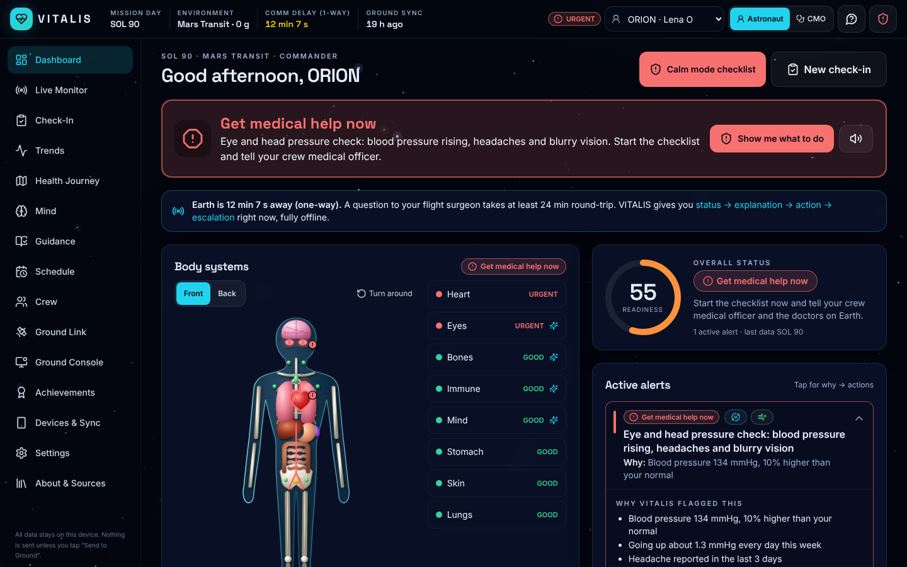

---

## The problem

On the ISS a flight surgeon is a few seconds away. On a Mars mission the one-way light-time is **4–22 minutes**, so a question and its answer take up to **45 minutes**. There is no resupply and no quick way home. NASA's Human Research Program counts **Distance from Earth** among the five hazards of spaceflight for exactly this reason: crews must detect, understand and act on medical issues **autonomously**.

Raw numbers alone don't help. A non-medical crew member looking at "BP 133/82" needs to know three things: *Is that bad? Why? What do I do now? When do I escalate?*

## The solution

**Core insight:** on deep-space missions, communication delay means astronauts can't wait for a flight surgeon. VITALIS turns raw readings into clear

### `status → explanation → action → escalation`

…and it all works **fully offline**.

| Status | Short label | Meaning |
|---|---|---|
| 🟢 **All good** | GOOD | Within safe limits and normal *for you* |
| 🟡 **Keep an eye on it** | WATCH | Drifting. Recheck and follow the guide |
| 🟠 **Take action today** | ACT | Start the countermeasure today and tell your crew medical officer |
| 🔴 **Get medical help now** | URGENT | Start the checklist now; don't wait for Earth to answer |

Every alert says **why** in plain words (for example *"Blood pressure (top number) has been 10% higher than your normal for 3 days, plus headaches and blurry vision"*). It also gives a tickable action checklist and a comm-delay-aware escalation line: *"Ground response in ~24 min at the earliest. Start these steps now."*

### Try it in one click

```bash
npm install && npm run dev
```

Then open **http://localhost:5173/?demo=1&tour=1**. This loads 90 days of seeded data for a 4-person Mars Transit crew and starts the 60-second guided tour.

### Two ways to run

| Mode | What you get | Setup |
|---|---|---|
| **Local / demo** | Everything on one device, fully offline. `?demo=1` loads the seeded Mars crew. | Nothing. Just `npm run dev`. |
| **Real accounts** | Each astronaut **creates an account once**, data **syncs to Supabase**, and **Mission Control** follows the crew live from the **Ground Console**: realtime critical alerts, acknowledgements, messages to the crew. Still works offline: writes wait in an outbox and upload when a link exists. | Free Supabase project + run `supabase/schema.sql` + 2 lines in `.env`. See **[docs/SUPABASE_SETUP.md](docs/SUPABASE_SETUP.md)**. |

**On every device, even offline:** install VITALIS as an app on your phone, tablet or laptop. Every page works with no internet. When a battery runs low, send your data to another device by Bluetooth, Nearby Share, AirDrop or USB cable, with no network needed. See **[docs/OFFLINE_AND_DEVICES.md](docs/OFFLINE_AND_DEVICES.md)**.

**Automatic measurement:** the **Live Monitor** connects standard **Bluetooth medical devices** (heart-rate straps, pulse oximeters, BP cuffs, thermometers, scales) and **suits/wearables over USB or Wi-Fi** using an open JSON-lines protocol. An ESP32 reference sketch and an EVA simulator with fault injection are included. See **[docs/SENSORS.md](docs/SENSORS.md)**.

### Project documents

| Document | What's in it |
|---|---|
| [PRODUCT_REQUIREMENTS.md](PRODUCT_REQUIREMENTS.md) | Problem, personas, user stories, functional & non-functional requirements, metrics, risks |
| [ARCHITECTURE.md](ARCHITECTURE.md) | Full architecture: layers, flows, data model, security model, decisions |
| [ARCHITECTURE_ESSENTIALS.md](ARCHITECTURE_ESSENTIALS.md) | One-page architecture summary |
| [AGENTS.md](AGENTS.md) | Rules, commands and "where to change what" for contributors |
| [CONTRIBUTING.md](CONTRIBUTING.md) | How to set up, make a change and open a pull request |
| [SECURITY.md](SECURITY.md) | Privacy and security model, keys, reporting a vulnerability |
| [CHANGELOG.md](CHANGELOG.md) | What changed in each version |
| [docs/OFFLINE_AND_DEVICES.md](docs/OFFLINE_AND_DEVICES.md) | User guide: install, offline use, device hand-off, watches, battery, alarm sounds |
| [docs/DEPLOYMENT.md](docs/DEPLOYMENT.md) | Deploy to Vercel, Render, Netlify or Cloudflare Pages |
| [docs/SUPABASE_SETUP.md](docs/SUPABASE_SETUP.md) · [docs/SENSORS.md](docs/SENSORS.md) | Accounts setup · sensor integration |

---

## Features

| # | Feature | Highlights |
|---|---|---|
| 1 | **Daily check-in** (< 3 min) | 8-step wizard, 56-px glove-friendly controls (± buttons, slider, keyboard), live status chip per value, 3-minute timer. 16 indicators plus a 12-item symptom checklist. Every indicator has an **ⓘ How to measure in space** panel: steps, why it matters in spaceflight, normal range and NASA hazard tags. |
| 2 | **Camera vitals** *(experimental)* | Webcam **rPPG** heart rate: forehead ROI (tracked with the Shape Detection API when available), green-channel average for 20 s, resampling, detrending, Hann window and FFT, a **0.7–3 Hz band-pass**, then the peak → bpm. Shows a live filtered waveform and a **confidence score**. A simulated-signal mode lets you demo it without a webcam. Plus an **image log** (skin, eye, ultrasound) attached to a body region. |
| 3 | **Interactive body map** | Hand-built SVG figure, front and back. 8 clickable, keyboard-focusable systems coloured by status. The **heart pulses at your latest HR**, and flagged regions glow. The side panel shows what the system does, spaceflight effects, linked HRP hazards and risk, indicators with sparklines, explanation, actions and when to escalate. |
| 4 | **Risk & triage engine** | Transparent and rule-based, with **108 unit tests** in total. Layer A: absolute thresholds. Layer B: **personal baseline** (14-day mean/SD, \|z\| > 2, sustained 3-day trends), which catches *"normal on paper, abnormal for YOU"*. Layer C: **11 combination rules** (SANS cluster, behavioral health, solar particle event, bone-loss proxy, sleep debt, infection, kidney stone risk, and more). |
| 5 | **Trends & analytics** | Recharts for all 19 indicators: shaded **normal band**, shaded **personal baseline band**, status-coloured points, **event markers** (EVA, solar event, illness, intervention), a 7/30/90-day toggle, and **correlation insights** (*"On days with <6 h sleep, your reaction time was 25% slower"*). |
| 6 | **Cognitive & behavioral health** | 2-minute **PVT** reaction-time test (mean/median RT, lapses ≥500 ms, false starts, compared to baseline). **Mood journal** with private notes, a 5-item **isolation & confinement wellbeing score**, a *connect-with-home* reminder, and an animated **4-7-8 breathing** guide. |
| 7 | **Countermeasures library** | 19 sourced protocol cards: resistive and aerobic exercise, nutrition, hydration, sleep under spacecraft lighting, **SPE storm-shelter protocol**, SANS self-check, motion sickness, infection control, medication safety, and more. Every flagged indicator links straight to its card. |
| 8 | **Mission routine & smart prompts** | Daily timeline (morning vitals, exercise blocks, evening mood, weekly SLAMMD mass, monthly exam) with prompts at scheduled times. **Adapts to risk**: for example, twice-daily BP checks and an Amsler test while SANS is flagged, or hourly fluid reminders when kidney-stone risk is raised. |
| 9 | **Crew-positive gamification** | XP, levels, streaks and badges (*Bone Guardian, Sleep Commander, Storm Ready, Mars-Ready…*) for **habits, never outcomes**. **Cooperative** weekly crew challenges show crew totals only, never a leaderboard of anyone's health data. Mission **readiness score 0–100**. |
| 10 | **Crew Medical Officer view** | Role toggle. All crew cards at a glance (status, readiness, mini-trends, top alert), a severity-sorted **alert queue** with acknowledge, and one tap to any crew member's dashboard. Private journal notes are never shown. |
| 11 | **Ground link & flight-surgeon report** | **Send to Ground** builds a gzip-compressed JSON health packet (private notes excluded) plus a **one-page PDF** with charts and alerts. Transmission is simulated with the mission's light-time (demo time-warp configurable). A simulated **flight-surgeon reply**, tailored to the top alert, arrives after the round trip. |
| 12 | **AI health assistant** *(optional)* | Explains *your* data in plain language from the engine's output. **Offline by default** (template answers from the rule engine). Optional Groq LLM layer, **OFF by default**. Guardrails: never diagnoses or doses, urgent phrases trigger emergency guidance, and every answer ends with the triage level and escalation path. |
| 13 | **Demo mode + guided tour** | One click: 90 days × 4 crew on Mars Transit with a scripted story (see below). The 10-step, ~60-second **guided tour** spotlights each feature. |
| 14 | **Live Monitor (sensors)** | Web Bluetooth GATT health profiles (HR + RR→HRV, SpO₂, BP, temperature, mass), Web Serial and WebSocket suit/wearable telemetry, EVA simulator with 6 injectable faults. Debounced live alarms (sound + checklist), 1-minute aggregates stored and synced, check-in auto-fill from devices. |
| 15 | **Accounts & sync** | Supabase Auth (email + password, hashed by Supabase). Missions with separate **crew** and **ground** invite codes (role comes from the code). Row Level Security: astronauts see only their own health data; CMO and ground see the crew; journals are owner-only. Offline outbox in IndexedDB, Realtime for alerts, messages, packets and vitals. |
| 16 | **Ground Console** | For Mission Control and the CMO: crew cards with readiness, triage status and **live sensor strips**; a realtime act/critical **alert feed with acknowledge**; per-crew **messages** (delivered to the astronaut's Ground Link inbox); health packets with one-click PDF. |
| 17 | **Radiation exposure panel** | Today's dose vs the environment's typical level, mission total vs the NASA 600 mSv career limit, peak day (e.g. solar particle event), days left at the current rate. Built around the CSA radiation-monitoring resource. |
| 18 | **About & Sources** | All five official Space Apps resources with links, how each shaped the app, "Benefits on Earth", and the non-endorsement statement. |
| 19 | **Health Journey** | A day-by-day **health map** (body areas × days, 30/40/60/90-day views) with mission events marked, a **body replay** that animates your body day by day, and **"How space is changing your body"** cards comparing your first and latest days (weight, heart, blood pressure, sleep, mood, strength exercise, reactions, radiation) in plain words. |
| 20 | **Many ways to enter data** | Check-in starts with *"How do you want to add today's numbers?"*: type them in, **scan a health report** (photo or pasted text → values found automatically, you confirm), **connect a Bluetooth device**, or use the **camera**. |
| 21 | **Feelings & home** | Days away from Earth, a **30-day mood calendar**, and **"Right now, this might help"** suggestions that change with your mood, stress and sleep (talk to a crewmate, message home, calm breathing, 3 good things). |
| 22 | **Status banner + sounds** | A big banner says how you are today (*"You're doing well today 💚"* or a pulsing red *"Get medical help now"*). On opening the app: a soft chime when all is good, a loud repeating beep + phone vibration when urgent. Can be turned off in Settings. |
| 23 | **Plain language** | No medical training needed: simple names ("Oxygen in your blood", "Blood pressure (top number)", "Take action today"), plain explanations in every alert, and a **"Medical words made simple"** glossary. |
| 24 | **Chatbot daily summary** | The assistant opens by telling you today's condition, your readings (✅ ⚠️ 🔴) and what to do today, and can answer *"How am I changing over time?"*. |
| 25 | **Animated space background** | Twinkling, slowly drifting stars and the occasional shooting star (still when "reduce motion" is on). |
| 26 | **Devices & offline sync** | Install as an app (button + app-icon shortcuts). Shows whether the device is ready to work offline, protects stored data from being cleared, shows battery. **Hand-off file** to your other phone/tablet/laptop by share sheet, Bluetooth, Nearby Share, AirDrop, USB or memory card: it **merges** (nothing deleted, safe to repeat). A brand-new device can **continue from your other device** on the welcome screen, offline. |
| 27 | **Low-battery hand-off** | Warnings at 20 % and 10 % with a one-tap *Send to another device*, so a dead battery never stops monitoring. |
| 28 | **Watch connection** | Reads heart rate from Garmin, Polar, Coros, Suunto, Wahoo, Amazfit and chest straps over Bluetooth, with per-brand instructions and a phone-camera fallback. |
| 29 | **Reliable alarm sounds** | *Test beep*, a beep when the alarm is turned back on, danger alarms that repeat every 20 s, and instant silence when muted. |
| – | **Calm mode** | For emergencies: strips the UI to one huge, high-contrast instruction checklist with *Alert CMO* and *Send packet* buttons. |

### The demo mission story (ARES-1, Mars Transit, SOL 90)

| Crew | Story the data tells |
|---|---|
| **ORION**, Lena Ortiz (CDR) | Sleep-deficit week (days 18–25) with slower PVT. From day 76, BP creeps up, then headaches, then vision change on days 88–90, giving 🔴 **SANS cluster alert today** |
| **SAGE**, Kenji Mori (CMO) | Upper-respiratory infection on days 12–15 (fever + congestion → 🟠 possible infection). Otherwise healthy |
| **NOVA**, Amara Diallo (MS) | Mood decline mid-mission (days 45–62) → 🟠 behavioral alert → **intervention on day 58** → recovered |
| **ATLAS**, Viktor Halvorsen (PLT) | Resistive-exercise adherence falls from day 35 and body mass drops 3.6%, giving 🟠 **bone-loss proxy**. Low fluids in the last days raise kidney-stone risk |
| Whole crew | **Solar particle event on day 42**: dosimeters jump to ~40 mSv (≈22× background), triggering 🔴 the storm-shelter protocol |

Every story beat is asserted in `src/engine/triage.test.ts`.

---

## Space Apps resources used

These are the official resources for this challenge. All five are linked inside the app on the **About & Sources** page (and from the relevant screens).

| Resource | What it shaped in VITALIS | Where to see it |
|---|---|---|
| **NASA — [5 Hazards of Human Spaceflight](https://www.nasa.gov/hrp/hazards/)** | Every measurement, alert, guidance card and body system is tagged with its hazard and icon. "Distance from Earth" is the core idea: escalation advice is timed to the comm delay ("ground response in ~24 min, start these steps now"). | Start page, dashboard hazard strip, every alert |
| **NASA — [Risks of Human Spaceflight](https://www.nasa.gov/hrp/risks/)** | Each body system maps to its HRP risk (SANS, cardiovascular, osteoporosis, muscle loss, behavioral health, immune, nutrition, renal stones, dust). Combination rules target these risks. Each body-system panel links to the risk page. | Body map → any system |
| **NASA — [Ongoing HRP Research in Space](https://www.nasa.gov/hrp/ongoing-hrp-research/)** | Countermeasure guides follow this research: resistive + aerobic exercise, sleep lighting, CO₂ and headaches, SANS eye checks, workload. PVT reaction testing and personal baselines mirror how in-flight studies track crew over time. Linked as "Further reading" on 10 guides. | Guidance library |
| **CSA — [Monitoring Radiation for Astronaut Health](https://www.asc-csa.gc.ca/eng/news/articles/2026/2026-02-26-monitoring-radiation-astronaut-health.asp)** | Daily personal-dosimeter reading in every check-in with limits scaled to the mission location; live dose-rate sensor channel with alarms; solar-particle-event detection → storm-shelter checklist; **Radiation exposure panel** (today, mission total vs the NASA 600 mSv career limit, peak day, days left at the current rate). Cited in the radiation thresholds. | Dashboard → Radiation exposure; Guidance → storm shelter |
| **CSA — [Why Do We Conduct Science Experiments in Space?](https://www.asc-csa.gc.ca/eng/iss/science/why-do-we-conduct-science-experiments-in-space.asp)** | The "Benefits on Earth" case below. | About & Sources page |

### Benefits on Earth

As the CSA notes, research done for space also improves life on Earth. The problem VITALIS solves (no doctor nearby, a slow or missing connection, a person who needs to know what to do *now*) exists on Earth too:

- **Remote & rural healthcare:** clear status, a plain-language "why" and next steps, even offline.
- **Polar & research stations:** Antarctic winter-over crews face isolation and delayed evacuation, just like a Mars crew.
- **Ships, submarines & offshore platforms:** small crews, no doctor aboard, intermittent satellite links.
- **Disaster response:** works when networks are down; syncs to coordinators when a link returns.
- **Home monitoring:** personal baselines catch "normal on paper, abnormal for you" changes in chronic conditions.

### Additional scientific sources

- **NASA Human Research Program: the five hazards of human spaceflight** (Radiation, Isolation & Confinement, Distance from Earth, Gravity Fields, Hostile/Closed Environments). Every indicator, alert, guidance card and body system is tagged with its hazard(s) and icon.
- **HRP risk descriptions / Human Research Roadmap.** Each body system maps to its HRP risk: SANS; cardiovascular adaptations; early-onset osteoporosis; reduced muscle mass; adverse cognitive/behavioral conditions; altered immune response; inadequate food & nutrition; renal stone formation; celestial dust exposure.
- **NASA-STD-3001 Vol. 1 Rev B** (radiation career limit 600 mSv; crew health standards) and **Vol. 2** (atmosphere).
- **HRP Evidence Reports** (SANS, Bone, Muscle, Behavioral Health, Immune, Nutrition, Radiation) for the spaceflight-effects text and countermeasure cards.
- **Space-environment dose rates:** MSL RAD cruise (Zeitlin 2013, 1.84 mSv/day), MSL RAD Mars surface (Hassler 2014), Chang'e-4 LND lunar surface (Zhang 2020).
- **ISS countermeasure literature:** ARED/T2/CEVIS exercise (Loehr 2015), sleep and lighting (Barger 2014), SLAMMD body mass, CO₂ and headaches (Law 2014), PVT (Basner & Dinges 2011).

Every threshold carries a source comment in [`src/engine/thresholds.ts`](src/engine/thresholds.ts) and is shown in Settings → Triage thresholds.

---

## Architecture

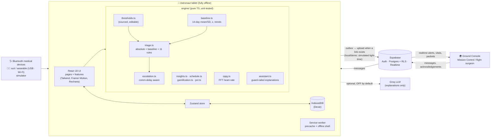

**Triage pipeline**

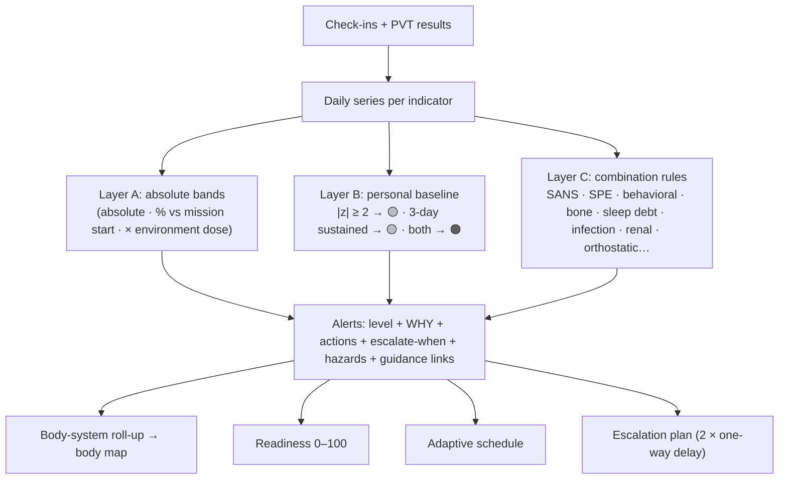

### Project structure

```
src/
  cloud/        Supabase client, sync engine (outbox, pull, realtime, broadcast), row mappers
  devices/      Bluetooth GATT parsers, telemetry protocol, device hub, live alarms, EVA simulator
  components/   Layout, AlertCard, ErrorBoundary, OwnDataGuard, Toasts, UI primitives
  features/     bodymap, checkin, trends, ground (packet/PDF/simulator), assistant, tour, calm
  engine/       thresholds, baseline, triage, escalation, insights, schedule, gamification, pvt, rppg,
                assistant, journey, reportParser, wellbeing, radiation, merge (+ *.test.ts)
  data/         environments, hazards, systems, indicators, guidance, seed (demo generator)
  store/        Dexie DB + Zustand store
  pages/        Onboarding, Auth, Dashboard, Live, CheckIn, Camera, Trends, Journey, SystemDetail,
                Cognitive, Guidance, Schedule, Crew, Ground, Console, Achievements, Devices, Settings,
                About, LockScreen
  hooks/        useRoute (hash router), useMission (context, triage), useTasks
  utils/        units, helpers, event bus, alarm sounds, device (battery, storage, share), install, service worker
public/         manifest, icons, sw.js (hand-written; precache list injected at build)
supabase/       schema.sql (tables, RLS, invite-code functions) + tests/ (RLS checks on plain Postgres)
docs/           OFFLINE_AND_DEVICES, DEPLOYMENT, SUPABASE_SETUP, SENSORS, hardware/ (ESP32 sketch), screenshots/
render.yaml     Render Blueprint (static site + cache headers)
```

---

## How to run

Requirements: Node 18+ (tested on Node 22).

```bash
npm install
```

```bash
npm run dev          # http://localhost:5173  (append ?demo=1&tour=1 for the judged demo)
```

```bash
npm test             # Vitest: engine, baseline math, rPPG, gamification, assistant guardrails
```

```bash
npm run lint         # ESLint (typescript-eslint, react-hooks)
```

```bash
npm run build && npm run preview   # production build with service worker → http://localhost:4173
```

### Deploy

Push to GitHub, then import the repo in **Vercel** (zero config) or create a **Render** Blueprint (`render.yaml` is included). Full steps for Vercel, Render, Netlify and Cloudflare Pages: **[docs/DEPLOYMENT.md](docs/DEPLOYMENT.md)**.

### Real accounts (optional)

```bash
cp .env.example .env   # set VITE_SUPABASE_URL and VITE_SUPABASE_ANON_KEY (see docs/SUPABASE_SETUP.md)
```

On Windows PowerShell use `Copy-Item .env.example .env`. Restart `npm run dev` after editing `.env`.

### Optional AI layer

```bash
cp .env.example .env   # set VITE_GROQ_API_KEY, then enable it in Settings → AI explanation layer
```

The app is 100% functional without it. When enabled, only the rule-engine **summary** (not journal notes) is sent, and only while online.

> Note: a `VITE_` variable is embedded in the client bundle. For a public deployment, put the key behind a small proxy instead.

---

## Quality

- **TypeScript strict**, no `any` (enforced by ESLint `no-explicit-any`). `npm run lint` is clean.
- **108 Vitest tests** cover the device hand-off merge, thresholds, baseline/z-score math, every combination rule, the full 90-day demo story, escalation timing, insights, the adaptive schedule, PVT scoring, rPPG recovery of 54–130 bpm from noisy jittery signals, gamification and assistant guardrails.
- **Lighthouse** (production build, mobile emulation):

  | Page | Accessibility | Best practices | Performance |
  |---|---|---|---|
  | Onboarding | 100 | 100 | 85 |
  | Dashboard | 100 | 100 | 77 |
  | Trends | 100 | 100 | 79 |
  | Check-in | 96 | 100 | 73 |
  | CMO crew | 100 | 100 | 87 |
  | Ground link | 100 | 100 | 77 |
  | Mind | 100 | 100 | 86 |

  Lighthouse 12 no longer has a PWA category. Installability and offline were verified directly: the web manifest has 192/512/maskable icons and shortcuts, the service worker precaches every built asset, and with the network cut the production build reloads and **all 20 pages work on desktop and phone sizes**. A two-device test confirms a brand-new device can start offline from a hand-off file.
- **17 database security checks** (`supabase/tests/rls_test.sql`) run on plain PostgreSQL.
- **Accessibility:** WCAG AA colours; status is never conveyed by colour alone (icon + text + colour); full keyboard support (body-map regions are focusable buttons); ARIA labels; skip link; focus management on navigation; reduced-motion and **high-contrast** modes; ≥ 44 px touch targets (56 px on check-in controls).
- **Privacy:** all data stays in IndexedDB. Optional PBKDF2 passcode lock; JSON export/import; wipe all. Nothing leaves the device unless you tap *Send to Ground*, send a hand-off file, or enable the AI layer. See [SECURITY.md](SECURITY.md).
- An **error boundary** around each page means one failing view can't take down the app.

## Screenshots

| | |
|---|---|
| 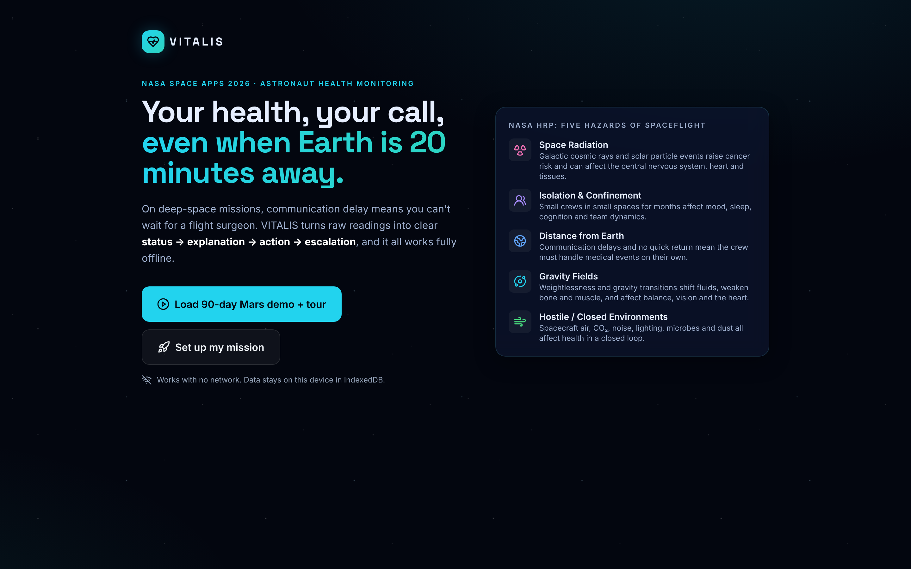 Onboarding & HRP hazards | 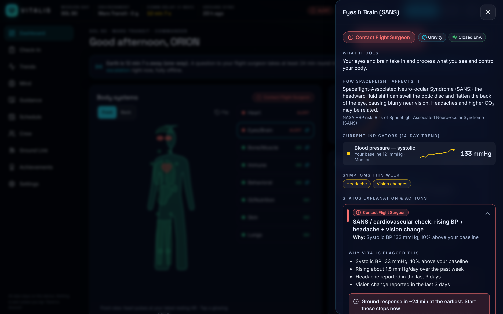 Body-system side panel |
| 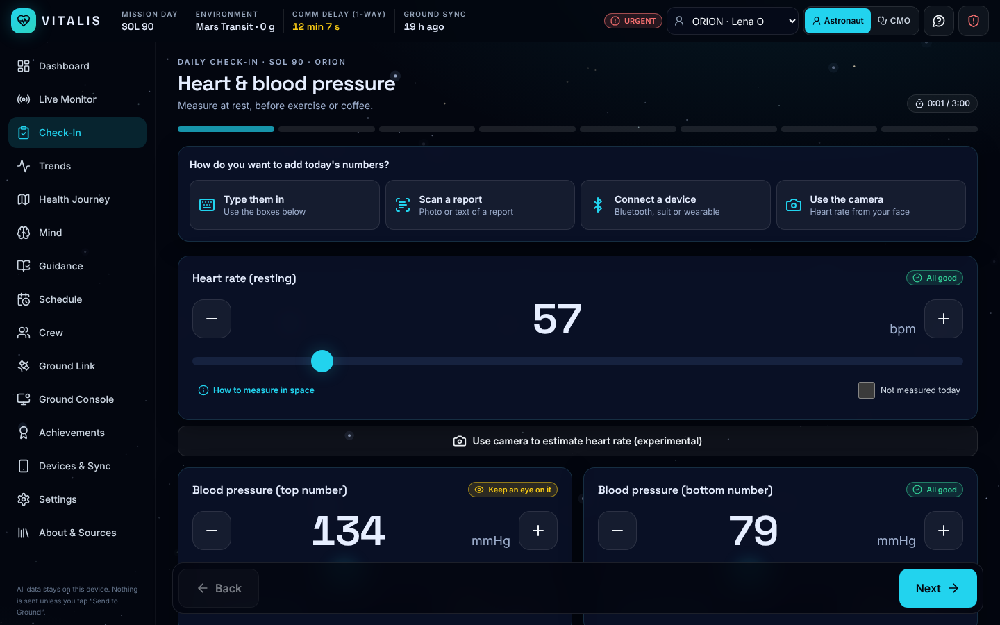 Check-in with "How to measure in space" | 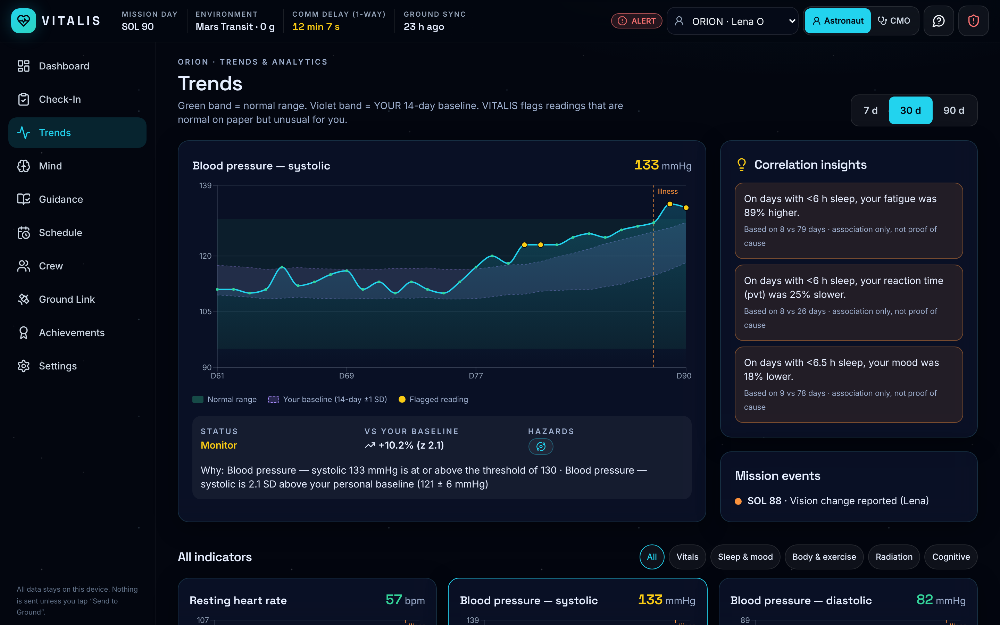 Trends with normal + personal baseline bands |
| 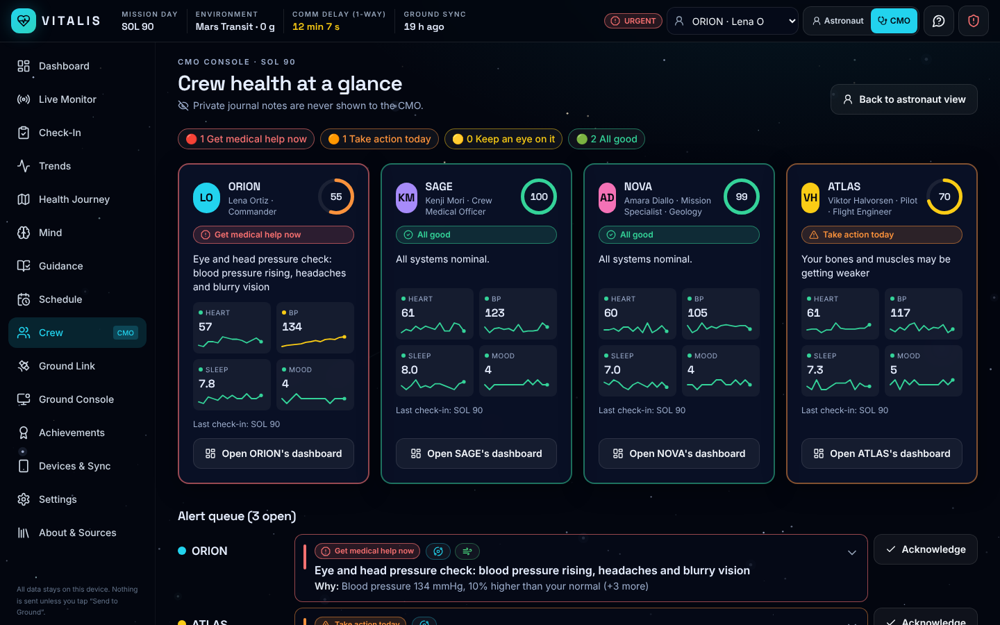 Crew Medical Officer view | 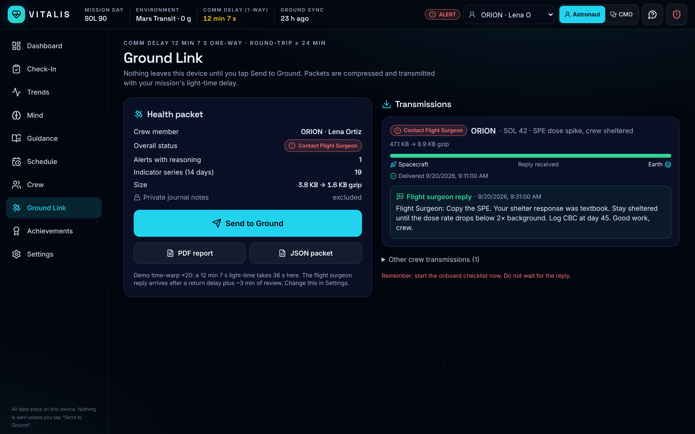 Ground link with light-time delay |
| 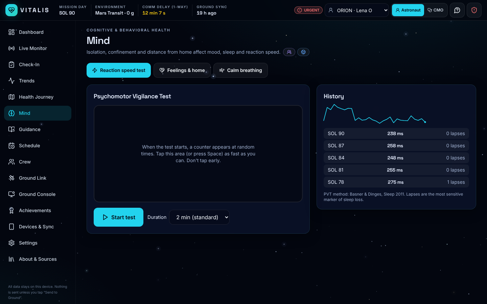 PVT reaction-time test | 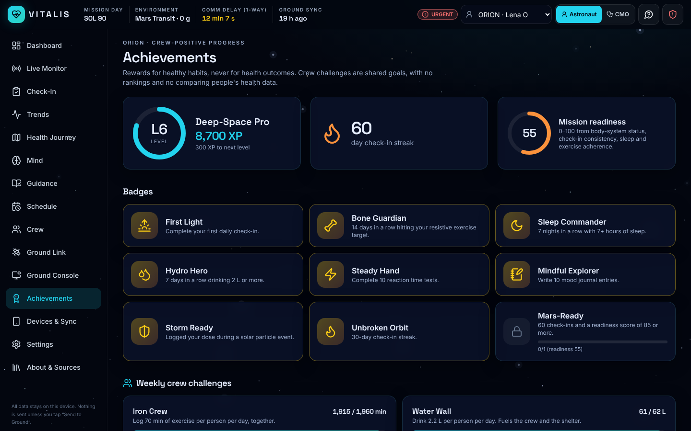 Crew-positive achievements |
| 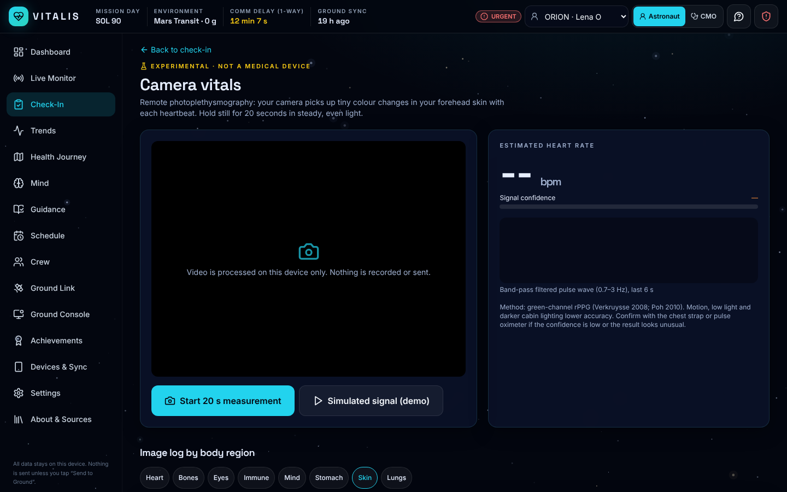 Experimental camera rPPG | 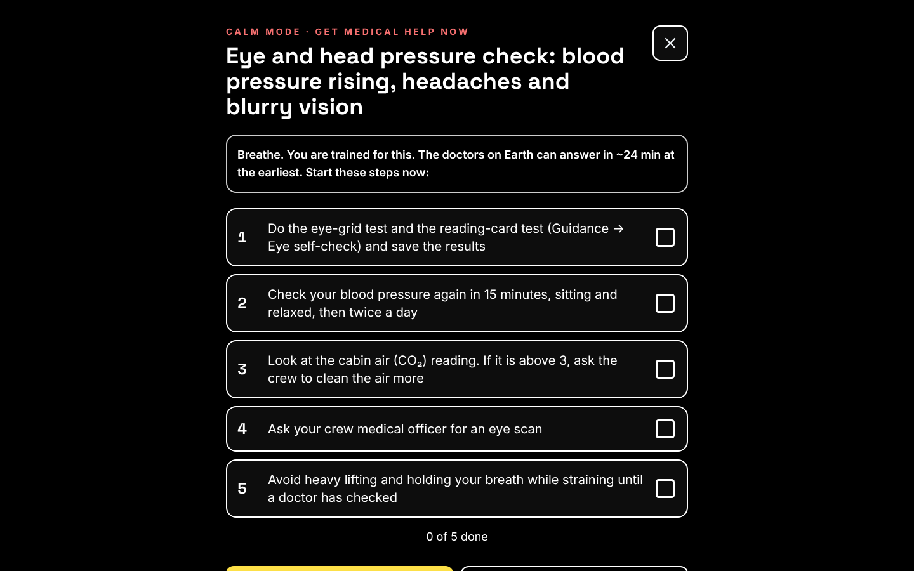 Calm mode |

<p align="center">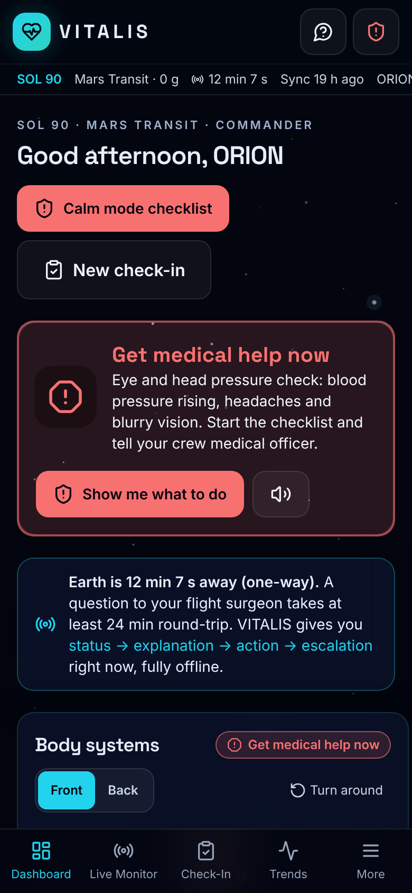</p>

---

## Limitations

- **Not a medical device.** Thresholds are general adult reference values compiled for a prototype. A real mission would set crew-specific values with the flight surgeon. VITALIS is decision support, not diagnosis.
- **Camera rPPG is experimental.** It is sensitive to motion, lighting and skin tone, and has not been clinically validated. Always confirm with a contact sensor.
- **Device integration** uses standard Bluetooth health profiles and an open telemetry protocol. Real flight suits need a vendor bridge. Web Bluetooth/Serial work only in Chromium browsers (not iOS Safari or Firefox).
- The **bone-loss proxy** uses exercise adherence and body mass. True bone density needs imaging (DXA/pQCT) or biomarkers.
- In **local/demo mode** the ground link and flight-surgeon replies are simulated. With Supabase, sync and messages are real but use the internet; a real mission would forward through DTN/Deep Space Network links.
- Supabase's free plan is not certified for real patient data (e.g. HIPAA). Use made-up data for prototypes.
- Live sensor broadcast uses Supabase Realtime Broadcast on the mission's private UUID channel. Stored data is protected by RLS; broadcast messages are not persisted.
- Images in the image log stay on the device (not synced to the cloud; they are included in hand-off files).
- Hand-off files are not encrypted: send them only to your own devices. Battery level is only available in Chromium browsers (Chrome, Edge, Android).
- With accounts, the first sign-in on a new device needs internet; after that it works offline.
- Correlation insights are descriptive associations on small samples, not causal claims.

## Future work

- More sensors: actigraphy for sleep, continuous BP, ECG patches (and private Realtime channels for live streams).
- **ML anomaly detection** (multivariate, e.g. isolation forest or LSTM autoencoders) alongside the rule engine, always with explanations.
- **Artemis / Mars mission integration:** sync with vehicle telemetry (cabin CO₂, ppO₂, dosimetry, space-weather alerts) and the onboard medical kit inventory.
- **Automatic nearby-device sync** (WebRTC on a local network) and passphrase-encrypted hand-off files, building on today's file hand-off.
- Delay-tolerant networking (DTN/Bundle Protocol) for ground packets.
- Validated psychometric instruments and flight-surgeon-configurable rule sets.
- Multilingual support for international crews.

---

> ⚠️ **Disclaimer:** VITALIS is decision support, not diagnosis. It never replaces your Crew Medical Officer or flight surgeon. If in doubt, escalate.

> **Non-endorsement:** VITALIS was built for the NASA Space Apps Challenge 2026 using publicly available NASA and CSA resources. It is not endorsed by NASA, the Canadian Space Agency or any space agency, and they are not responsible for its content. Use of each linked website is subject to that website's own terms and data-use parameters.
